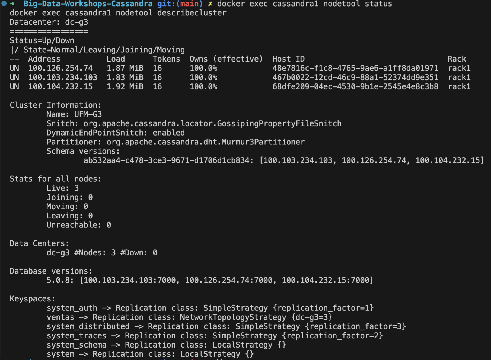
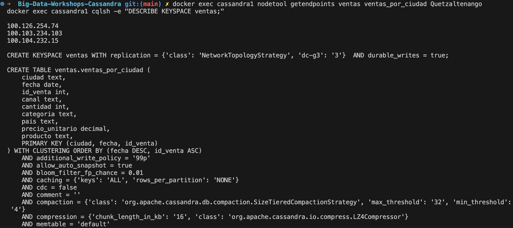
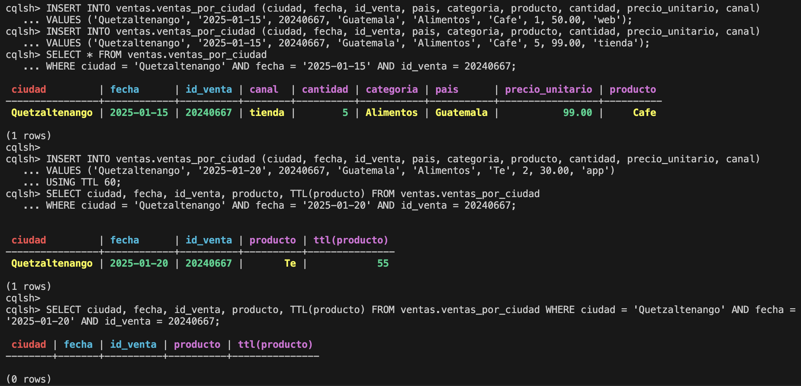
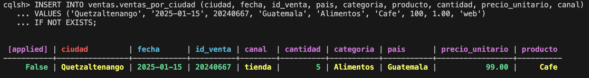
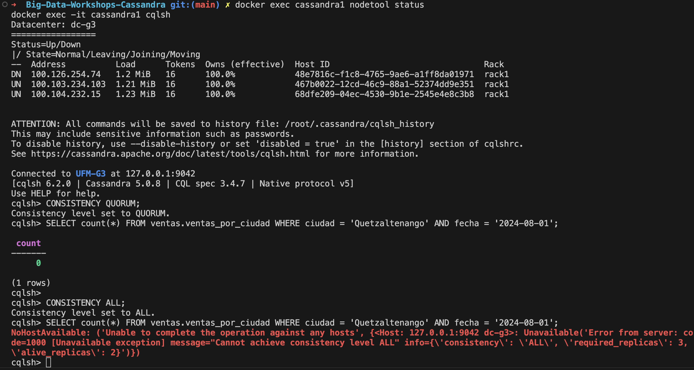
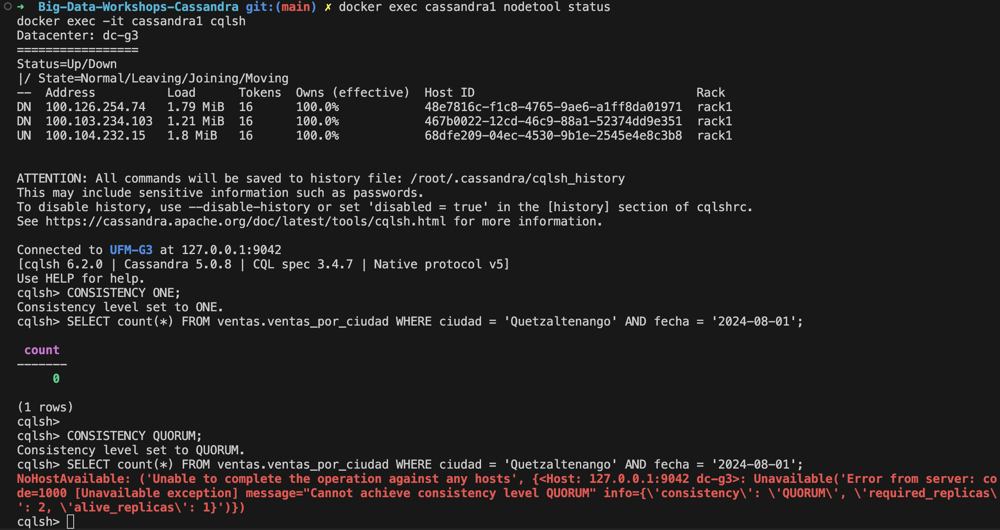
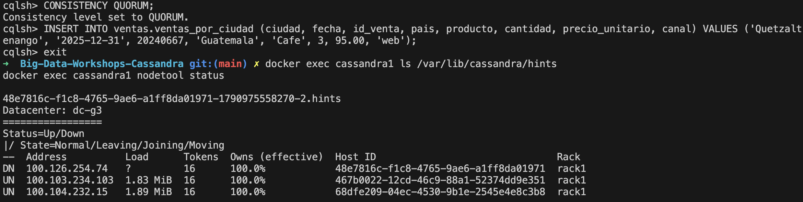
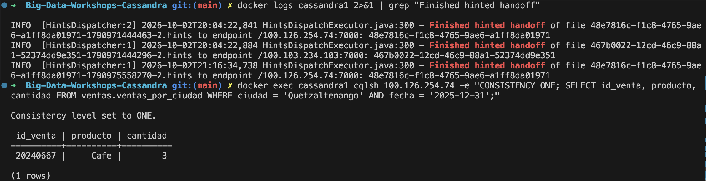

# Bitácora del taller de Cassandra

- Philip Falla
- 20240667
- Grupo 3
- Nodo Seed Cassandra1

---

## 1. Evidencias

### E1. Tres nodos en tu clúster y tu datacenter

`nodetool status` nos muestra los tres nodos arriba con `UN` en `dc-g3`, cada uno con la IP de Tailscale de la PC de cada integrante. `describecluster` nos confirma el nombre `UFM-G3`.

### E2. Las copias de la partición de Quetzaltenango

`getendpoints` nos muestra las tres IP del clúster para la partición `Quetzaltenango`, y `DESCRIBE KEYSPACE` muestra `'dc-g3': '3'`. Con 3 copias y 3 nodos, cada nodo tiene todos los datos.

### E3. Upsert, TTL e IF NOT EXISTS

Dos `INSERT` con la misma llave (`Quetzaltenango`, `2025-01-15`, `20240667`) dejan una sola fila, con los valores del segundo (`tienda`, 5, 99.00). La fila insertada con `USING TTL 60` aparece con 55 segundos restantes y, pasado el minuto, el mismo `SELECT` devuelve `(0 rows)`.

El `INSERT ... IF NOT EXISTS` sobre la llave del upsert no se aplica: responde `[applied] False` y muestra la fila que ya existía.

### E4. Un nodo caído: QUORUM frente a ALL

Con `cassandra3` caído, en `DN`, la lectura con `QUORUM` responde y la misma lectura con `ALL` se rechaza con `required_replicas: 3, alive_replicas: 2`.

### E5. Dos nodos caídos: ONE frente a QUORUM

Con `cassandra2` y `cassandra3` en `DN`, la lectura con `ONE` responde usando solo mi nodo, y con `QUORUM` se rechaza con `required_replicas: 2, alive_replicas: 1`.

### E6a. El hint guardado para el nodo caído

Después de escribir mi venta con `QUORUM` y `cassandra3` apagado, en `/var/lib/cassandra/hints` aparece `48e7816c-f1c8-4765-9ae6-a1ff8da01971-1790975558270-2.hints`. Ese es el mismo Host ID de la fila `DN` en `nodetool status`.

### E6b. La entrega del hint

Al volver `cassandra3`, el log de mi nodo muestra `Finished hinted handoff` de ese archivo hacia `/100.126.254.74:7000`. Leyendo con `ONE` directamente desde ese nodo aparece mi venta `20240667`.

### Tabla del Paso 8

| Nodos caídos | `ONE` | `QUORUM` | `ALL` |
|---|---|---|---|
| 0 | ✅ | ✅ | ✅ |
| 1 | ✅ | ✅ | ❌ |
| 2 | ✅ | ❌ | ❌ |

---

## 2. Preguntas

**1. ¿Qué línea de la traza muestra que la consulta por ciudad leyó una sola partición, y cuál que la de producto recorrió toda la tabla? ¿Por qué Cassandra rechaza la segunda sin ALLOW FILTERING?**

En la consulta por ciudad (`Quetzaltenango`, `2024-12-18`) la línea clave es `Executing single-partition query on ventas_por_ciudad`, seguida de `Read 7 live rows and 0 tombstone cells`: fue directo a una partición y leyó solo esas 7 filas. En la de `producto = 'Miel'` aparece `Submitting range requests on 49 ranges` y luego varios `Executing seq scan across 1 sstables`, cada uno con `Read 1427 live rows`, `Read 1623 live rows`, etc., hasta recorrer las 75 000 filas para devolver 4851. Cassandra la rechaza sin `ALLOW FILTERING` porque `producto` no es parte de la partition key: no sabe en qué nodos buscar y tendría que leer toda la tabla, así que obliga a pedirlo de forma explícita.

**2. ¿Qué lecturas se comportaron como CP y cuáles como AP? ¿Qué nivel usarías para el saldo de una cuenta y cuál para un contador de reproducciones, y por qué?**

`ALL` y `QUORUM` se comportaron como CP: en mi E4, `ALL` falló con `alive_replicas: 2`, y en E5 `QUORUM` falló con `alive_replicas: 1`; prefirieron no responder antes que dar un dato que quizás no está al día. `ONE` se comportó como AP: respondió incluso con dos nodos caídos, solo con la copia de mi nodo. Para el saldo de una cuenta usaría `QUORUM` al leer y al escribir, porque 2 + 2 > 3 garantiza que la lectura ve la última escritura, y un saldo viejo es un error grave. Para un contador de reproducciones usaría `ONE`: si el número está un poco atrasado no pasa nada, y lo importante es que siempre responda rápido.

**3. ¿Cómo se enteró el nodo apagado de tu venta? ¿Qué pasaría si el nodo estuviera apagado más tiempo que max_hint_window?**

Mi nodo coordinó la escritura con `QUORUM`: la guardó en su copia y en la del nodo vivo, y como `cassandra3` (Host ID `48e7816c-f1c8-4765-9ae6-a1ff8da01971`) estaba `DN`, guardó un hint para él en `48e7816c-…-1790975558270-2.hints`. Cuando volvió, mi nodo se lo entregó, como muestra la línea `Finished hinted handoff of file 48e7816c-…-1790975558270-2.hints to endpoint /100.126.254.74:7000`. Si el nodo hubiera estado apagado más que `max_hint_window` (3 horas por defecto), mi nodo habría dejado de guardar hints para él, y al volver no tendría las escrituras de ese tiempo. Una lectura con `ONE` que cayera en esa copia podría devolver datos incompletos hasta correr `nodetool repair`.

---

## 3. Mini-reto

### Tablas

| Tabla | Consulta que responde | Partition key | Clustering key |
|---|---|---|---|
| `usuarios_por_id` | C1 | `usuario_id` | (ninguna) |
| `mensajes_por_canal` | C2 | `canal_id` | `enviado_en DESC, mensaje_id` |
| `mensajes_por_usuario` | C3 | `usuario_id` | `enviado_en DESC, mensaje_id` |
| `mensajes_por_canal_dia` | C4 | `(canal_id, dia)` | `enviado_en, mensaje_id` |

### Justificación

**Por qué esas llaves:**

La partition key de cada tabla es lo que la consulta filtra con `=`, para que cada consulta lea una sola partición. En C1 se busca por `usuario_id` y hay una fila por usuario, así que no hace falta clustering key. En C2 y C3 la partición es el canal o el usuario, y la clustering key `enviado_en DESC` deja los mensajes guardados del más nuevo al más viejo: el `LIMIT 20` o `LIMIT 10` toma los primeros sin ordenar nada al leer. Agregué `mensaje_id` al final para que dos mensajes con la misma hora no se pisen por el upsert. En C4 metí el día en la partition key, `(canal_id, dia)`: el `COUNT(*)` cuenta una partición completa, y además las particiones no crecen sin límite con el tiempo. La columna `dia` no existe en SQL; la calculo en la carga desde `enviado_en`, en UTC.

**Qué datos quedaron duplicados entre tablas:**

Cada uno de los 6000 mensajes está guardado tres veces: en `mensajes_por_canal`, en `mensajes_por_usuario` y en `mensajes_por_canal_dia`. Además, lo que en SQL venía de un JOIN quedó copiado en cada mensaje: `nombre_usuario` en `mensajes_por_canal` (y también en `usuarios_por_id`), y el nombre del canal y del servidor en `mensajes_por_usuario`. A cambio de ese espacio y de escribir cada mensaje nuevo en tres tablas, ninguna consulta necesita JOIN.

**Qué hace la aplicación si cambia un dato duplicado:**

Cassandra no actualiza las copias sola; lo tiene que hacer la aplicación. Si un usuario cambia su `nombre_usuario`, primero se actualiza `usuarios_por_id`. Luego se leen sus mensajes en `mensajes_por_usuario` (partición `usuario_id`), que da el `canal_id`, `enviado_en` y `mensaje_id` de cada uno, y con eso se reescribe cada fila en `mensajes_por_canal`. Por eso guardé `canal_id` en esa tabla aunque C3 no lo muestre. Si cambia el nombre de un canal o de un servidor, se hace lo mismo al revés: se leen los mensajes del canal en `mensajes_por_canal`, que guarda `usuario_id`, y se actualizan en `mensajes_por_usuario`. Mientras tanto, las tablas pueden mostrar nombres distintos por un momento.